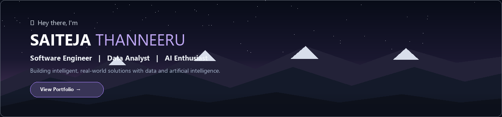
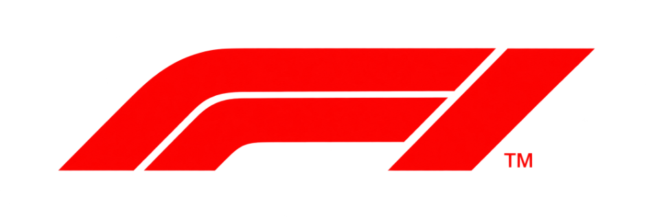
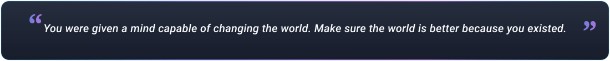

<!-- ======================================================== -->
<!-- 1. HERO BANNER (LANDSCAPE ONLY - NO PROFILE PHOTO)       -->
<!-- ======================================================== -->

 

<!-- ======================================================== -->
<!-- 2. ABOUT ME                                              -->
<!-- ======================================================== -->
### 👤 About Me

> B.Tech graduate in **Computer Science (Data Science)** from Malla Reddy College of Engineering and Technology (2022–2026).  
> Passionate about building robust software, scalable data pipelines, and intelligent AI solutions that solve real-world problems.

- 💻 **Software Engineering** — Full-stack web applications, clean architecture, and RESTful APIs
- 📊 **Data Analytics** — Data preparation, exploratory analysis, interactive dashboards, and business intelligence
- 🤖 **Machine Learning & AI** — Predictive modeling, Generative AI, RAG architectures, and agentic workflows

 

<!-- ======================================================== -->
<!-- 3. TECH STACK & TOOLS                                    -->
<!-- ======================================================== -->
### 💻 Tech Stack & Tools

| Category | Technologies & Tools |
| :--- | :--- |
| **Languages** |  **Python** &nbsp;•&nbsp;  **Java** &nbsp;•&nbsp;  **JavaScript** &nbsp;•&nbsp;  **TypeScript** |
| **Frontend** |  **HTML5** &nbsp;•&nbsp;  **CSS3** &nbsp;•&nbsp;  **React** &nbsp;•&nbsp;  **Tailwind CSS** &nbsp;•&nbsp;  **Vite** |
| **Backend & DB** |  **Django** &nbsp;•&nbsp;  **Node.js** &nbsp;•&nbsp;  **Supabase** &nbsp;•&nbsp;  **PostgreSQL** &nbsp;•&nbsp;  **Firebase** |
| **Data Analytics** |  **Power BI** &nbsp;•&nbsp;  **Tableau** &nbsp;•&nbsp;  **SQL** |
| **Machine Learning** |  **Scikit-learn** &nbsp;•&nbsp;  **Pandas** &nbsp;•&nbsp;  **NumPy** &nbsp;•&nbsp;  **OpenCV** |
| **AI & LLMs** |  **Generative AI** &nbsp;•&nbsp;  **Agentic AI** &nbsp;•&nbsp;  **RAG** &nbsp;•&nbsp;  **AI Agents** &nbsp;•&nbsp;  **Prompt Engineering** |
| **Tools & Platforms** |  **Git** &nbsp;•&nbsp;  **GitHub** &nbsp;•&nbsp;  **VS Code** &nbsp;•&nbsp;  **Linux** &nbsp;•&nbsp;  **PowerShell** &nbsp;•&nbsp;  **REST APIs** |

 

<!-- ======================================================== -->
<!-- 4. PROFESSIONAL JOURNEY (VERTICAL CAREER TIMELINE)       -->
<!-- ======================================================== -->
### 🚀 Professional Journey

<table width="100%">
  <tr>
    <td width="32" align="center" valign="top">
      
       
      
    </td>
    <td valign="top">
      <strong>Vajra.ai</strong> &nbsp;•&nbsp; <em>Data Science with AI Intern</em> 
      <small><code>📅 September 2025 – Present</code></small> 
      Building data science pipelines, AI agent workflows, and predictive machine learning models.
    </td>
  </tr>
  <tr>
    <td width="32" align="center" valign="top">
      
       
      
    </td>
    <td valign="top">
      <strong>SKATE Technologies</strong> &nbsp;•&nbsp; <em>Co-Founder & Software Developer</em> 
      <small><code>📅 2025 – Present</code></small> 
      Leading full-stack software development, responsive web architectures, and AI-enabled product features.
    </td>
  </tr>
  <tr>
    <td width="32" align="center" valign="top">
      
       
      
    </td>
    <td valign="top">
      <strong>CodSoft</strong> &nbsp;•&nbsp; <em>Data Science Intern</em> 
      <small><code>📅 February 2025 – April 2025</code></small> 
      Conducted exploratory data analysis, data preprocessing, visualization, and predictive modeling.
    </td>
  </tr>
  <tr>
    <td width="32" align="center" valign="top">
      
    </td>
    <td valign="top">
      <strong>TechSaksham</strong> (AICTE & Edunet Foundation) &nbsp;•&nbsp; <em>AI Intern</em> 
      <small><code>📅 January 2025 – April 2025</code></small> 
      Developed AI-powered applications, Python ML solutions, and data analytics workflows.
    </td>
  </tr>
</table>

 

<!-- ======================================================== -->
<!-- 5. EDUCATION & CERTIFICATIONS                            -->
<!-- ======================================================== -->
### 🎓 Education & Certifications

#### 📘 Education
- **Bachelor of Technology — Computer Science (Data Science)**  
  *Malla Reddy College of Engineering and Technology* &nbsp;•&nbsp; 2022 – 2026 &nbsp;•&nbsp; **Graduate**

#### 📜 Certifications & Credentials
-  **AWS Academy Graduate — Cloud Foundations Training** &nbsp;•&nbsp; [Credly Badge](https://www.credly.com/org/amazon-web-services/badge/aws-academy-graduate-cloud-foundations-training-bad)
-  **Applied AI Foundations \| Agents and Workflows** &nbsp;•&nbsp; *OpenAI Academy*
-  **Python Essentials** &nbsp;•&nbsp; *Cisco Networking Academy*
-  **Data Analytics Essentials** &nbsp;•&nbsp; *Cisco Networking Academy*
-  **Introduction to Networks (CCNA)** &nbsp;•&nbsp; *Cisco Networking Academy*
-  **Data Visualization with Power BI** &nbsp;•&nbsp; *Tata*

  

 

<!-- ======================================================== -->
<!-- 6. BEYOND CODING (EXACTLY 6 BOXES - 3 COLUMNS x 2 ROWS)  -->
<!-- ======================================================== -->
### 🌌 Beyond Coding

<table width="100%">
  <tr>
    <td width="33.33%" align="center" valign="top">
       
      
      <h4>Marvel Universe</h4>
      
Enjoy exploring Marvel characters, stories, and its cinematic universe.

       
    </td>
    <td width="33.33%" align="center" valign="top">
       
      
      <h4>Formula 1</h4>
      
Interested in motorsport, racing strategy, and engineering innovation.

       
    </td>
    <td width="33.33%" align="center" valign="top">
       
      
      <h4>Cricket</h4>
      
Enjoy watching and playing cricket.

       
    </td>
  </tr>
  <tr>
    <td width="33.33%" align="center" valign="top">
       
      
      <h4>Gaming</h4>
      
Enjoy competitive gaming and strategic gameplay, especially BGMI.

       
    </td>
    <td width="33.33%" align="center" valign="top">
       
      
      <h4>Technology Explorer</h4>
      
Curious about emerging technologies, AI, and new innovations.

       
    </td>
    <td width="33.33%" align="center" valign="top">
       
      
      <h4>Problem Solver</h4>
      
Enjoy breaking complex problems into practical solutions.

       
    </td>
  </tr>
</table>

 

<!-- ======================================================== -->
<!-- 7. PERSONAL QUOTE (PROMINENT CLOSING BANNER)             -->
<!-- ======================================================== -->
---

 

 

---

 

<!-- ======================================================== -->
<!-- 8. LET'S CONNECT                                         -->
<!-- ======================================================== -->
### 🤝 Let's Connect

  
  &nbsp;&nbsp;
  
  &nbsp;&nbsp;
  
  &nbsp;&nbsp;
  

Designed with care &nbsp;•&nbsp; Built with code &nbsp;•&nbsp; Driven by data & AI

