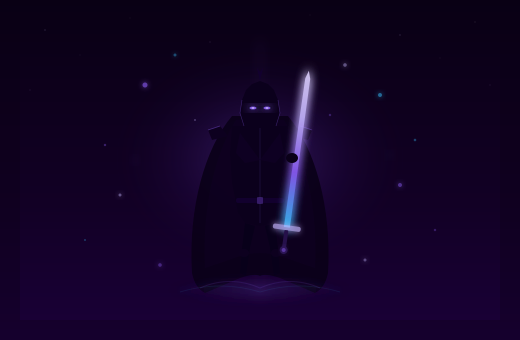

<!-- ================================================================ -->
<!--       SAITEJA THANNEERU · Premium GitHub Profile README          -->
<!--       Theme: Midnight Purple / Futuristic Developer Portfolio    -->
<!--       Palette: #090014 · #25104A · #8B5CF6 · #36BCF7 · #C4B5FD  -->
<!-- ================================================================ -->

<!-- ======================= HERO SECTION ========================== -->

 

<table border="0">
<tr>
<td align="center" width="200">

</td>
<td align="left">

✨ Hey there! I'm
 

## SAITEJA *THANNEERU*

**`Software Engineer`** · **`Data Analyst`** · **`AI Enthusiast`**

 

  

&nbsp;

</td>
</tr>
</table>

---

<!-- =================== ABOUT ME + TECH STACK ==================== -->

<table>
<tr>

<!-- ─────────────── ABOUT ME (Left Card) ─────────────── -->

<td width="35%" valign="top">

### 🧑‍💻 About Me

I'm a **B.Tech Graduate in Computer Science (Data Science)**, passionate about software engineering, data analytics, and artificial intelligence.

I love turning ideas into practical, impactful solutions by combining technology, creativity, and analytical thinking.

 

🔮 **Full-Stack Development**
 
📊 **Data Analytics & Visualization**
 
🤖 **Machine Learning & AI**
 
🧠 **Generative & Agentic AI** (RAG, AI Agents)
 
🚀 **Continuous Learning & Building**

</td>

<!-- ─────────────── TECH STACK (Right Card) ─────────────── -->

<td width="65%" valign="top">

### ⚡ Tech Stack & Technologies

<table>
<tr>

<td align="center" valign="top">

**`💻 Languages`**
  

</td>

<td align="center" valign="top">

**`🧪 ML & Data Science`**
  

</td>

</tr>
<tr>

<td align="center" valign="top">

**`🎨 Frontend`**
  

</td>

<td align="center" valign="top">

**`🧠 Generative & Agentic AI`**
  

 

</td>

</tr>
<tr>

<td align="center" valign="top">

**`⚙️ Backend & Database`**
  

</td>

<td align="center" valign="top">

**`🔗 APIs & Integration`**
  

</td>

</tr>
<tr>

<td align="center" valign="top">

**`📊 Data Analytics`**
  

</td>

<td align="center" valign="top">

**`🛠️ Tools & Platforms`**
  

</td>

</tr>
</table>

</td>

</tr>
</table>

---

<!-- ============= JOURNEY + EDUCATION + CERTS ==================== -->

<table>
<tr>

<!-- ─────────────── MY JOURNEY (Left) ─────────────── -->

<td width="38%" valign="top">

### 🛤️ My Journey

 

 &nbsp; **AI Intern — TechSaksham**
 
&nbsp;&nbsp;&nbsp;&nbsp;&nbsp;&nbsp;&nbsp;&nbsp;&nbsp;&nbsp; 📅 `JAN 2025 – APR 2025`

Worked on AI-powered applications, Python development, machine learning, data preprocessing and model development.

---

 &nbsp; **Data Science Intern — CodSoft**
 
&nbsp;&nbsp;&nbsp;&nbsp;&nbsp;&nbsp;&nbsp;&nbsp;&nbsp;&nbsp; 📅 `FEB 2025 – APR 2025`

Worked on machine learning and data analytics projects involving data preprocessing, model training, evaluation and visualization.

---

 &nbsp; **Co-Founder & Dev — SKATE Technologies**
 
&nbsp;&nbsp;&nbsp;&nbsp;&nbsp;&nbsp;&nbsp;&nbsp;&nbsp;&nbsp; 📅 `2025 – PRESENT`

Co-founded SKATE Technologies, contributing to modern web applications and AI-enabled solutions with a focus on scalability and user-focused digital products.

---

 &nbsp; **Data Science with AI Intern — Vajra.ai**
 
&nbsp;&nbsp;&nbsp;&nbsp;&nbsp;&nbsp;&nbsp;&nbsp;&nbsp;&nbsp; 📅 `SEP 2025 – PRESENT`

Working with the Technology team on data science and AI-focused activities, gaining practical experience in data-driven applications and artificial intelligence.

</td>

<!-- ─────────────── EDUCATION (Center) ─────────────── -->

<td width="24%" valign="top" align="center">

### 🎓 Education

  

🎓

**B.Tech (Graduate)**

**Computer Science**
**(Data Science)**

 

Malla Reddy College of Engineering and Technology

 

📅 `2022 – 2026`

  

</td>

<!-- ─────────────── CERTIFICATIONS (Right) ─────────────── -->

<td width="38%" valign="top">

### 🏆 Certifications & Credentials

 

  

 

✅ Applied AI Foundations | Agents and Workflows — **OpenAI Academy**

✅ Python Essentials — **Cisco Networking Academy**

✅ Data Analytics Essentials — **Cisco Networking Academy**

✅ Introduction to Networks — **Cisco**

✅ Data Visualization with Power BI — **Tata**

</td>

</tr>
</table>

---

<!-- ============= EXPLORE MY WORLD + IGRIS ======================= -->

<table>
<tr>

<!-- ─────────────── EXPLORE MY WORLD (Left) ─────────────── -->

<td width="55%" valign="top">

### 🌐 Explore My World

 

<table>
<tr>

<td align="center" width="33%">

🧩
 
**Problem Solver**
 
Breaking complex problems into practical solutions.

</td>

<td align="center" width="33%">

🔬
 
**Technology Explorer**
 
Curious about emerging technologies and AI.

</td>

<td align="center" width="33%">

🦸
 
**Marvel Universe**
 
A Marvel enthusiast who loves the universe, characters and epic storytelling.

</td>

</tr>
<tr>

<td align="center">

🏎️
 
**Formula 1**
 
A motorsport fan fascinated by racing strategy and innovation.

</td>

<td align="center">

🏏
 
**Cricket**
 
Enjoy watching and playing cricket, appreciating strategy and teamwork.

</td>

<td align="center">

🎮
 
**Gaming (BGMI)**
 
Gaming enthusiast who enjoys competitive gameplay, especially BGMI.

</td>

</tr>
</table>

</td>

<!-- ─────────────── IGRIS AI ASSISTANT (Right) ─────────────── -->

<td width="45%" valign="top">

### ⚔️ Meet IGRIS — My AI Assistant

 

<!-- Shadow Knight illustration — commit igris-banner.svg alongside README.md -->

 

**Inspired by IGRIS from *Solo Leveling*.**

My personal AI assistant that helps visitors explore my portfolio, technical skills, education and professional journey.

*Ask questions. Explore my work. Get to know me.*

 

  

</td>

</tr>
</table>

---

<!-- ==================== PERSONAL QUOTE ========================== -->

 

  

### *"You were given a mind capable of changing the world. Make sure the world is better because you existed."*

 

  

---

<!-- ==================== LET'S CONNECT =========================== -->

## 🤝 Let's Connect

 

&nbsp;

&nbsp;

&nbsp;

  

### Building Today. **Innovating Tomorrow.**

 

---

<!-- ======================== FOOTER ============================== -->

